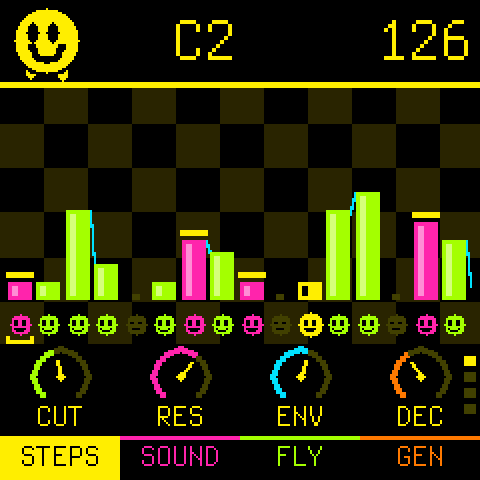
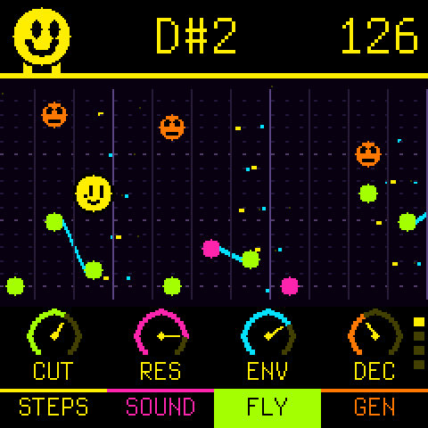
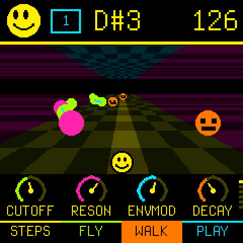
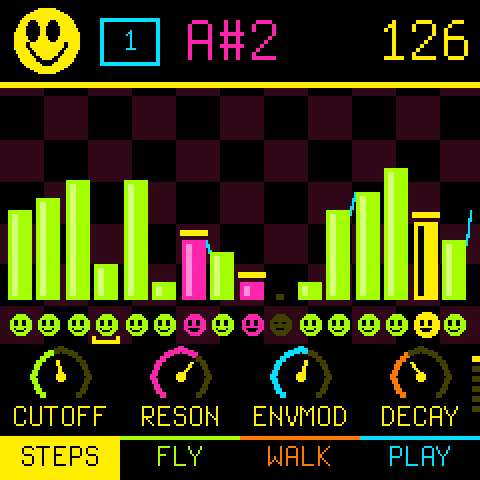
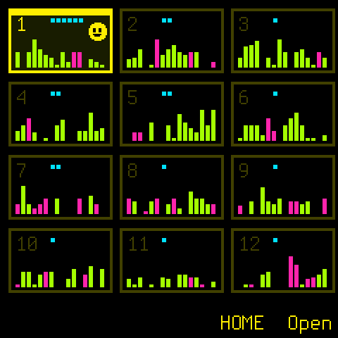
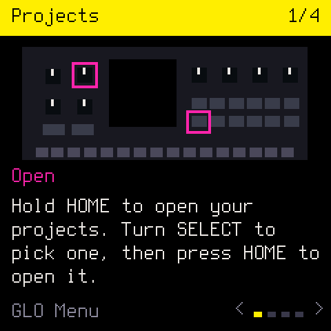

# Smileyface

Acid bass line thing for the FM-1. Think TD-3-MO, but in your FM-1! (Beta.)

  
  

## What is it

A simple (to me) workflow for making acid. Write a pattern, then twist the knobs.

## Links

- [Play online](https://ihavenocluewhatimdoing.com/smileyface/play/)
- [Install](https://ihavenocluewhatimdoing.com/smileyface/install.html)
- [Guide](https://ihavenocluewhatimdoing.com/smileyface/guide/)
- [Cheat sheet](https://ihavenocluewhatimdoing.com/smileyface/cheatsheet/)

## Tested?

- On a real FM-1, yep!

## Licence

GPL-3.0-only, see `LICENSING.md`. Built on [Chipbox](https://github.com/pbarilla/chipbox), which is built on
[Dinghy](https://github.com/zvenson/dinghy), which is built on [Felucca](https://github.com/hugelton/Felucca) by Leo Kuroshita
(Hügelton Instruments) with the changes of [SLOOP](https://github.com/isod89/sloop-fm1) (isod89).
