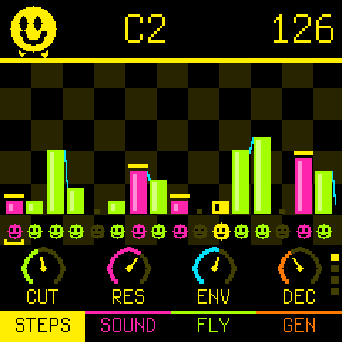
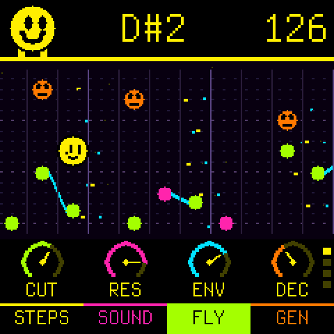
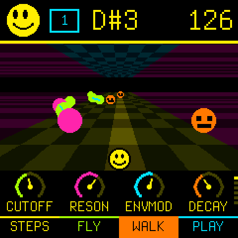
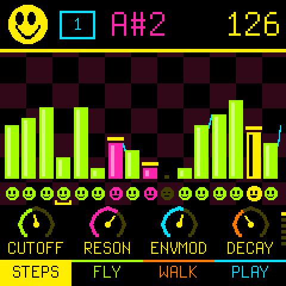
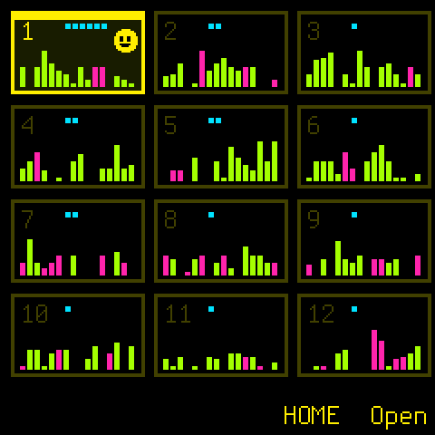
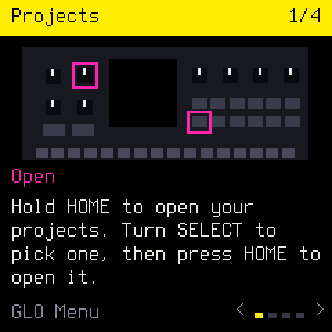

# Smileyface

Make some Acid on your FM-1!

  
  

## What is it

A simpleworkflow for making acid. Write a pattern (or smash that LFO button to roll the dice), and then twist the knobs.

## Lessons

GLO + HOME opens the menu; its first line starts one of 13 guided lessons.

## Links

- [Homepage] (https://ihavenocluewhatimdoing.com/smileyface/)
- [Play online](https://ihavenocluewhatimdoing.com/smileyface/play/)
- [Install](https://ihavenocluewhatimdoing.com/smileyface/install.html)
- [Guide](https://ihavenocluewhatimdoing.com/smileyface/guide/)
- [Cheat sheet](https://ihavenocluewhatimdoing.com/smileyface/cheatsheet/)

## Brothers Link (Bluetooth sync between the brothers)

Smileyface, [Chipbox](https://github.com/pbarilla/chipbox) and Drumlab can play together over Bluetooth. We call it Brothers Link: Bluetooth Low Energy underneath, but not standard BLE-MIDI. No cables, no pairing: one leads, the others follow. Any of them can lead.

- Tempo, play and stop follow the leader. Followers start at the next bar.
- Sidechain: the bass ducks on every kick the leader plays, then swells back. (Smileyface has no drums, so as a leader it sends no kicks.)
- Patterns: when the leader changes pattern, Smileyface changes at the end of its loop. A pattern with nothing in it is skipped. The leader's swing comes along.
- Punch-in FX: hold pads 1 to 8 on the leader and the followers do it too.
- Key: a following Smileyface moves its notes to the leader's key. A leading one tells the others its own.

Hit `GLO` + `HOME`, pick Bluetooth, set Sync to Lead on one FM-1 and Follow on the others (`OCT+` changes it). The switches below Sync are off until you turn them on. Sync is always Off after power-up, and set it to Off before you install a firmware.

Writing firmware for the FM-1? Add Brothers Link to yours: [the spec](brothers-link/BROTHERS-LINK.md), [a version for your coding agent](brothers-link/BROTHERS-LINK-FOR-AGENTS.md) and [the eight punch-in effects, with recipes](brothers-link/PUNCH-IN-FX.md).

### Why is it called Brothers Link?

Toyota refers to their trio of 80s and 90s sports cars as the Three Brothers. The Supra, Celica, and MR2. While developing these firmwares, I referred to each of them as one of these codewords. Chipbox was MR2, Smileyface was Celica, and Drumlab was Supra. Collectively, I call my three firmwares the Three Brothers. I also personally own an MR2 with a dreamcast installed in it, but that's another story...

### Do I need to call it Brothers Link?

Absolutely not. If you do choose to use the novel method for connecting 2+ FM-1s together over Bluetooth, call it whatever you like!

## Tested?

- Yep! Trust me, it's a lot of fun!

## Licence

GPL-3.0-only, see `LICENSING.md`. Built on [Chipbox](https://github.com/pbarilla/chipbox), which is built on
[Dinghy](https://github.com/zvenson/dinghy), which is built on [Felucca](https://github.com/hugelton/Felucca) by Leo Kuroshita
(Hügelton Instruments) with the changes of [SLOOP](https://github.com/isod89/sloop-fm1) (isod89).

You can also try Smileyface in the browser, no flashing needed, in the free community [FM-1 Emulator](https://fm1-emulator.atst.tools/).
