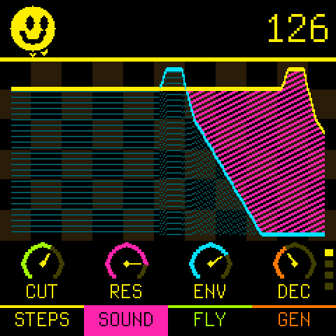
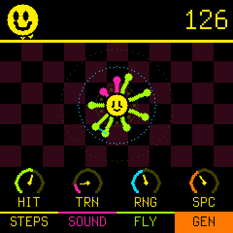
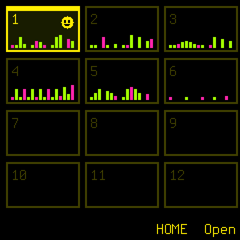

# Smileyface

An acid bass line for the M-VAVE FM-1. One 303-style voice, 16 steps, knobs to twist.

- **Steps**: press a key to write a note, `ENV` for an accent, `SEL` for a slide, `EDIT` for a rest.
- **Sound**: five pages of knobs: cutoff, resonance, env mod, decay; accent, slide, drive, wave; accent decay, tracking, soft attack, muffler; tune, sub, sweep, poles; filter FM, hi resonance, swing, length.
- **Fly**: steer a ship up and down the scale, every key fires. A shot is a note, no shot is a rest.

    

- **Gen**: hits spread over the 16 steps, a melody that wanders. Turn the knobs, roll the dice with `SELECT`.
- **Patterns**: hold `HOME` for 12 slots. `LFO` is a random pattern (it might rule, it might not), `ARP` nudges a few steps, `REC` undoes.
- `SEQ` taps the tempo. MIDI clock, start and stop are followed.

Forked from [Chipbox](https://github.com/pbarilla/chipbox), which is built on Felucca, SLOOP and Dinghy (GPL-3.0-only). See `LICENSING.md`.

## Build

`./build.sh` (Docker running; the JieLi toolchain in `~/.jieli/toolchain`, the SDK in `~/fw-AC79_AIoT_SDK`).
`python3 tools/fm1_install.py build/smileyface.fwsc --yes` flashes the FM-1.

On a computer: `cc -O2 -DSMILEY_HOST -DPOOL= '-D__attribute__(x)=' -DAPP_VER='"dev"' -Ifirmware/src -Ifirmware/gen -o build/host/smileyface firmware/src/smileyface.c -lm`,
then `build/host/smileyface build/host/s tests/steps.txt` (screens as PPM, the sound as WAV).
